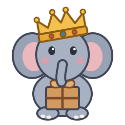

# BAB, the mascot

{ width="192" }

rab's mascot is **BAB**, a baby elephant king. His name comes from the
nickname for rab, the *Buchochelliq-labs Asset Bundle*. The picture above is a
placeholder until an artist draws him. This page is the brief for that artist.

## Who he is

BAB is very young and has just been crowned. He takes the job seriously. He
carries a parcel, the release's assets, carefully, by its string, and he does
not drop it. He is round, small and friendly, and a little earnest.

## Design brief

- **Shape.** A small, round baby elephant: a big head and a soft round body,
  short legs, large rounded ears, a short trunk. No tusks. Simple and
  readable at 64 px (a favicon) and up to a sticker.
- **The crown.** A simple gold crown with a few points and round tips,
  **slightly too big for him**: it sits low and tilts to one side. One or
  three small jewels at most.
- **The parcel.** A small brown paper parcel tied with string and a bow, a
  nod to "asset bundle". He holds it by the string with his trunk, or hugs
  it.
- **Style.** Flat vector shapes, one outline weight, no gradients needed. It
  must work on light and dark backgrounds (the docs site has both), and in
  one colour for a stamp or embroidery.
- **Expression.** Calm and pleased: round eyes, a hint of pink on the cheeks.
  Not a cartoon grimace, not sad, not angry.

## Palette

| Use | Colour | Hex |
|---|---|---|
| Skin | soft blue-grey | `#A7B1C2` |
| Ears (shade) | darker blue-grey | `#97A2B5` |
| Inner ears, cheeks | soft pink | `#EBB8BE`, `#E79AA6` |
| Outline | slate | `#3D4556` |
| Crown | gold, with an amber band | `#F2C14E`, `#E9A93A`, outline `#8A5A12` |
| Jewels | ruby and sapphire | `#D1495B`, `#3E7CB1` |
| Parcel | kraft brown | `#D29A5E`, string `#7A4B2A` |

Gold and kraft brown are BAB's colours. Avoid green as a main colour.

## Do

- Keep him a baby: big head, small body, short trunk.
- Keep the crown simple and slightly oversized.
- Keep the parcel: it is what makes him rab's mascot.
- Use a transparent background. Draw everything as shapes: no embedded
  images, no text, no external fonts.

## Don't

- **Not Babar**, and not any other existing character. BAB is an original
  design. **No green suit, no bowler hat**, no suit or clothes at all, no
  cane, and no resemblance to Jean de Brunhoff's character, his family or his
  style of drawing.
- No tusks, no realistic elephant (wrinkles, shading), no adult proportions.
- No royal regalia beyond the crown: no robe, sceptre or throne.
- No weapons, no logos of other projects or registries, no text in the
  picture.

## Files

- [`docs/assets/bab.svg`](https://github.com/buchochelliq-labs/release-asset-bundle/blob/main/docs/assets/bab.svg):
  the placeholder, 256 × 256, used in the README, as this site's logo and as
  its favicon. A final design replaces this file under the same name.
